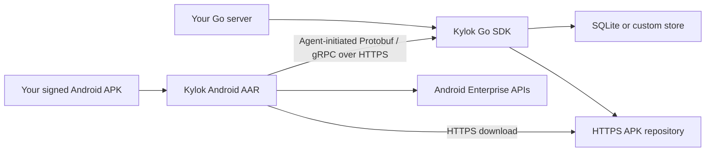

# Kylok — Self-hosted Android Device Management SDK

Kylok is an open-source Android mobile device management (MDM) SDK designed for self-hosted, on-premises deployments. Embed a Go management engine in your server and a Kotlin Device Policy Controller (DPC) library in your Android app to enroll devices, deploy APKs, and manage kiosk policies over your local network.

**Library-first · Local-first · Host-neutral · Extensible**

[Architecture](docs/architecture.md) · [Roadmap](ROADMAP.md) · [Implementation plan](docs/implementation-plan.md) · [Contributing guide](CONTRIBUTING.md)

> [!IMPORTANT]
> Kylok is at the design stage. This repository contains documentation; the SDKs, examples, and build tooling are not implemented or published yet. All capabilities below are planned. There is no installation command or supported device list yet.

## Why Kylok?

Kylok is intended for teams building tablet fleets, dedicated Android kiosks, and device management inside an existing product. The default integration will provide the management engine, persistence, enrollment, and device agent, while the host keeps its application identity, signing keys, authorization, and business UI.

- **Embed device management:** use a Go module and Android AAR with small public APIs.
- **Run on your infrastructure:** use local storage and HTTPS artifact delivery, with no Firebase, Google Cloud, Google Play, or WAN dependency during routine operation.
- **Start with working defaults:** SQLite, filesystem APK storage, provisioning handlers, and reconciliation are part of the planned default path.
- **Extend when needed:** replace storage, artifact delivery, events, and authorization through documented interfaces.

## Planned capabilities

| Capability | Intended behavior |
| --- | --- |
| QR provisioning | Download a signed host DPC APK from a LAN HTTPS endpoint and provision a Fully Managed Device Owner. |
| Secure enrollment | Exchange an expiring, single-use token for a device identity with revocation and safe retries. |
| Device inventory | Track device identity, Android version, agent version, capabilities, and reported status. |
| APK deployment | Verify and install signed APKs, report observed installation results, and update the host DPC. |
| Kiosk and policies | Reconcile required apps, Lock Task allowlists, runtime permissions, and basic device restrictions. |
| Offline recovery | Retain credentials and pending work across network loss, process restarts, and device reboots. |

The v1 design targets **Android API 33–37**, with a minimum API of 33 and compile/target API of 37. These are planning targets, not a compatibility claim. Fully Managed Device Owner is the initial management mode; Work Profile and COPE are outside the MVP.

Routine offline operation and offline provisioning are separate goals. Setup Wizard behavior and certificate trust depend on the device and firmware. LAN-only provisioning with WAN blocked is the first physical-device acceptance gate.

## How it will fit together

| Planned deliverable | Purpose |
| --- | --- |
| Kylok Go | Embeddable enrollment, device registry, policy, and deployment engine. |
| Kylok Android | AAR providing DPC provisioning, synchronization, policy execution, and APK installation. |
| `minimal-server` | Reference Go host using only public SDK APIs. |
| `minimal-dpc` | Reference Android host supplying its application ID and signing key. |

The host APK becomes Device Owner; an AAR does not independently acquire that role. The two SDKs share wire contracts and have independent release versions.

## Getting started today

1. Read the [architecture](docs/architecture.md) for component boundaries and lifecycle requirements.
2. Check the [roadmap](ROADMAP.md) for milestone outcomes and release gates.
3. Use the [implementation plan](docs/implementation-plan.md) to select a concrete work item.
4. Review the [contributing guide](CONTRIBUTING.md) before proposing a change.

The first implementation task is a small provisioning proof: a signed host APK embedding the AAR, a local HTTPS server distributing the APK and QR, and a factory-reset physical device with WAN access blocked. Broader implementation depends on that evidence.

## Documentation

| Document | What it covers |
| --- | --- |
| [Architecture](docs/architecture.md) | SDK boundaries, protocol, storage, trust, and device lifecycle. |
| [Roadmap](ROADMAP.md) | Public milestones, priorities, and v1 acceptance criteria. |
| [Implementation plan](docs/implementation-plan.md) | Dependencies, work packages, validation, and release preparation. |
| [Original design](design.md) | Original v1 draft in Vietnamese and the source for these documents. |
| [GitHub publishing guide](docs/github-publishing.md) | Suggested repository description, topics, keywords, and release tags. |

See [NOTICE](NOTICE) for the project's LGPL-3.0-only licensing declaration and [LICENSE](LICENSE) for the license text.
