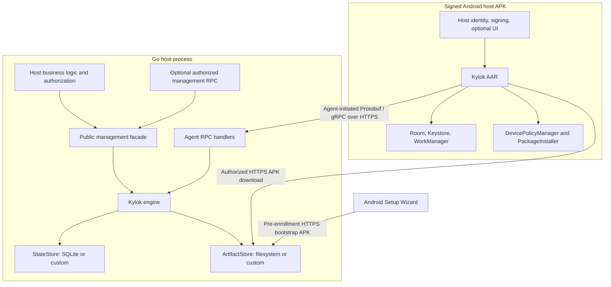
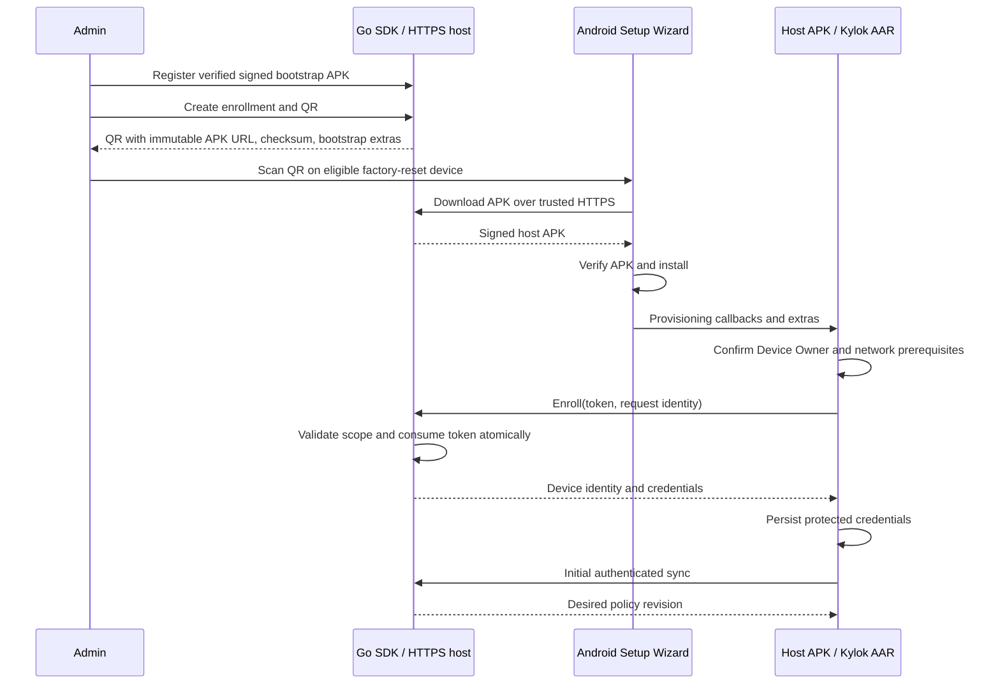

# Kylok architecture

**Status:** design baseline; no SDK implementation exists yet.

This document organizes the [original v1 design](../design.md) into an English architecture reference. Requirements describe intended behavior. APIs, package names, transport details, and platform support must be validated before release. Track delivery in the [roadmap](../ROADMAP.md) and [implementation plan](implementation-plan.md).

## Purpose and scope

Kylok is a library-first, self-hosted Android device management framework. It has two independently versioned products: a Go management SDK and a Kotlin Android AAR. Two public-API-only examples demonstrate integration. fDCMS is a prospective external consumer and must never become a Kylok dependency.

The v1 design targets Fully Managed Device Owner deployments, minimum Android API 33, and compile/target API 37. API 33–37 is a validation target, not current support. Work Profile, COPE, OEM extensions, system OTA, and remote screen control are outside the MVP.

Routine operation must not require Firebase, Google Cloud, Google Play, or WAN access. Offline provisioning is a distinct physical-device gate: Android Setup Wizard, firmware, and bootstrap TLS trust remain external constraints.

## Architectural principles

| Principle | Required consequence |
| --- | --- |
| Ready to use | A valid default configuration provides enrollment, persistence, registry, policies, artifact storage, QR generation, and agent handlers. |
| Explicit required configuration | Require a device-reachable HTTPS public URL, a validated signed bootstrap APK, and durable storage or complete replacement providers. |
| Optional customization | Hosts can replace meaningful adapters without implementing interfaces for the default path. |
| Native APIs | Use Android Enterprise APIs and idiomatic Go/Kotlin facilities rather than redundant abstractions. |
| Durable reconciliation | Desired and observed state, operations, and identity survive interruptions. |
| Security invariants | Hooks cannot bypass identity, scope, token, role, artifact, or idempotency checks. |
| Independent lifecycles | Hosts own application identity and signing; SDK versions and wire protocol versions are distinct. |

## System boundaries



| Component | Owns | Boundary |
| --- | --- | --- |
| Protobuf contracts | Typed resources, RPCs, errors, compatibility | No Go or Android business implementation. |
| Go SDK | Enrollment, identity, device state, policy and deployment orchestration | No Android application internals or consumer dependencies. |
| Android AAR | DPC components, local state, synchronization, policy execution, installation | No Go internals or business application dependencies. |
| Go host | Server lifecycle, HTTPS hosting, business authorization and UI | Uses the public SDK facade and handlers. |
| Android host | Application ID, stable signing key, signed APK publishing, optional UI | Embeds the AAR and validates the merged manifest. |
| Android OS | Ownership and permission enforcement, package installation | Cannot be bypassed by SDK initialization or hooks. |

Protobuf is the shared wire contract. Each SDK retains idiomatic domain models; generated messages stay at transport boundaries where practical. In-process Go calls invoke the engine directly rather than calling management RPC over loopback.

## Planned monorepo layout

Only the root documentation and `docs/` exist today. The following is the implementation layout, to be introduced incrementally:

```text
proto/kylok/v1/             # Single source of wire contracts
go/                        # Main Go module and public facade
  enrollment/ provisioning/ device/ policy/ application/ operation/
  ports/                   # Public adapter contracts
  adapters/                # SQLite, memory tests, filesystem
  transport/connect/       # RPC adapters
  gen/kylok/v1/            # Generated Go protocol code
  internal/                # Engine, identity, state, reconciliation
android/                   # Gradle root
  kylok-dpc/               # One published AAR, package-level internal boundaries
examples/
  minimal-server/          # Separate Go module
  minimal-dpc/             # Android application module included by Gradle
tests/                     # Contract, integration, provisioning, compatibility fixtures
tools/apk-metadata/         # Signed APK validation and metadata extraction
docs/                      # Architecture, implementation and future operational guides
.github/workflows/         # Future CI and release automation
```

One main Go module lives in `go/`; a development `go.work` will include it and `examples/minimal-server`. Android starts with one library module, `:kylok-dpc`, and the example application. Generate Kotlin messages into Android build output. Pin code-generation tools and enforce schema compatibility in CI. Examples must use public APIs with no SDK special cases or reverse dependencies.

## Go SDK construction and lifecycle

The draft facade exposes `Enrollments`, `Provisioning`, `Devices`, `Policies`, `Applications`, and `Operations`. Exact signatures are not frozen.

| Input | Requirement/default |
| --- | --- |
| `PublicURL` | Required device-reachable HTTPS origin/base URL. Host owns DNS and working TLS. |
| `Bootstrap` | Valid signed host DPC APK and matching extracted metadata for a full management instance. |
| `DataDir` | Required for persistence providers that use the default local storage. |
| `Store`, `Artifacts` | Optional replacements. If all persistent providers are supplied, `DataDir` is unnecessary. |
| Logger, clock, events | `slog`, system clock, and no-op event sink by default. |
| Policy validation, retry/sync settings | Built-in behavior with documented bounds; exact values remain to be specified. |
| Management authorization | In-process calls use the host's authorization boundary. Remote management exposure requires authentication and authorization. |

`New` validates options and provider combinations, checks the bootstrap APK/metadata, opens and migrates default storage, initializes artifact and enrollment services, and returns a ready instance. It must fail clearly on invalid or incomplete configuration, close resources it acquired on failure, and never fall back to temporary persistence.

Construction does not bind sockets, issue certificates, or start a public HTTP server. The Go host mounts SDK handlers and owns startup and graceful shutdown. Constructor, worker-start, cancellation, and `Close` ownership must be finalized before implementation. Remotely exposed management handler construction fails without suitable authentication/authorization; agent handlers use device authentication.

## Android SDK integration and lifecycle

The host APK embeds the AAR and becomes Device Owner through Android provisioning. Installing a normal APK and calling the SDK does not grant that role.

The AAR contributes a DeviceAdminReceiver, provisioning-mode and policy-compliance activities, installation-result receiver, required lifecycle receivers, permissions, and resources through manifest merging. Initialization must work from Android component lifecycle without requiring the host Activity to have opened.

The draft API offers automatic initialization, early `Application.onCreate()` configuration, and access to status, enrollment, policy, diagnostics, and event/policy hooks. Define configuration freeze and initialization ordering before relying on both automatic initialization and customization; hooks must not race with background startup.

Lifecycle vocabulary: `UNMANAGED`, `PROVISIONING`, `DEVICE_OWNER`, `ENROLLING`, `MANAGED`, `SUSPENDED`, `REVOKED`, and `ERROR`. The implementation must specify valid transitions, recovery, and persistence; these names alone do not define a complete state machine. Report Device Owner separately from successful server enrollment.

Use Room for revisions, operations, installation state, and reports; Android Keystore-backed protection for credentials; WorkManager for durable recovery scheduling; and app-private files for staging. Event-driven synchronization complements scheduled work. No realtime delivery guarantee is implied.

## Contracts and resource model

| Resource | Meaning |
| --- | --- |
| `Scope` | Isolated Kylok namespace; the host chooses how to map tenants/sites. |
| `Enrollment` | Scope-bound bootstrap token, expiry, artifact reference, and status. |
| `Device` | Identity, lifecycle, agent/OS versions, capabilities, reported state. |
| `Policy` | Typed desired state and revision. |
| `Application` | Package identity, version requirements, installation requirements. |
| `Artifact` | Immutable APK content digest and verified signing metadata. |
| `Operation` | Durable action, idempotency identity, progress, result. |
| `ComplianceReport` | Observed policy results, failures, unsupported fields. |

The initial `AgentService` defines enrollment, synchronization, status reporting, and operation reporting. An optional `ManagementService` adapts management operations for remote tooling. Agent authentication must never confer management rights or access to other devices/scopes.

Use typed Protobuf messages, stable IDs, policy revisions, protocol/agent version fields, capability reports, structured errors, and retryability classifications. Do not serialize the policy as opaque JSON. Reserve removed field numbers and check breaking changes with Buf.

The proposed default is unary gRPC, served by Connect-Go and consumed by gRPC-Java/OkHttp with Protobuf Lite. Validate this combination in a cross-language spike. APK bytes use separate HTTPS streaming endpoints, not RPC message bodies. Device connections originate from the agent; inbound device ports and cloud push are unnecessary for v1.

## Provisioning and enrollment flow



Build tooling derives package name, receiver class, version code, SHA-256 digest, and signing-certificate fingerprint from the signed APK. QR creation must reject conflicting metadata. Convert the verified APK digest into Android's required QR checksum representation. Set `EXTRA_PROVISIONING_ALLOW_OFFLINE` for the intended offline flow and validate the actual platform/OEM behavior.

Bootstrap APK access must work before device credentials exist. It is an immutable pre-enrollment download; access to it does not authorize enrollment or management. Later application artifacts require device/scope authorization. Enrollment tokens are short-lived, high-entropy, single-use, and scope-bound; store them and their verification state appropriately and avoid logging secrets.

Atomic token consumption, device creation, and retry records must agree. A lost enrollment response must allow the same legitimate attempt to recover one identity without allowing another device to reuse the token. The request-binding and credential recovery protocol is an explicit design decision for M1/M2; an unbound idempotency key alone is insufficient.

## Synchronization, policy, and operations

Keep three concepts distinct: **desired state** requested by the server, **observed state** on Android, and **compliance** comparing them. Policy is persistent intent. An operation is a durable action with its own lifecycle. A successful RPC is not evidence of successful policy application or installation.

The reconciler persists the desired revision, checks capabilities/prerequisites, applies steps in safe order, verifies observed results, and stores unsent reports. Use `APPLIED`, `PENDING`, `FAILED`, and `UNSUPPORTED` with structured reasons. Failures must support partial compliance. A newer policy revision arriving during work requires explicit supersession rules.

Install and verify the kiosk app before entering kiosk mode. Initial policies should be minimally restrictive: kiosk, camera/debugging restrictions, and recovery-limiting controls require administrator intent. Capability reports reflect the actual device, role, platform, and firmware; API level alone cannot prove support.

Persist identity, credentials, revision checkpoints, operation progress, installation session state, and pending reports before relying on them for recovery. Network loss, reboot, or process termination must resume work through checkpoints and deduplication. External Android effects and local storage are not one transaction; define reconciliation for interruption between effect and checkpoint rather than promising exactly-once delivery.

## APK lifecycle

Artifacts are content-addressed by SHA-256 and immutable after publication. Validate package identity, version code, digest, signing compatibility, and Android/device compatibility before installation. Verify downloaded bytes and package metadata again on the device. Garbage collection must retain artifacts referenced by active policies or deployments.

The agent downloads/stages an APK, creates and commits a PackageInstaller session, handles every callback including pending user action, verifies the installed package/version, and reports the observed result. A committed session alone is not success. Silent installation is conditional on supported Device Owner/platform behavior.

The MVP executes single/universal APK installations. Model installation sets without requiring split APK support yet. DPC self-update must preserve application ID, compatible signing, Device Owner status, protected identity, durable work, and reconnection. Arbitrary downgrade or rollback is not guaranteed.

## Persistence and extensibility

The default Go store is SQLite with migrations, appropriate WAL/transaction configuration, and a single-process/single-node deployment boundary. Default artifacts use the local filesystem. A custom store must provide the transactions, uniqueness, concurrency control, and operation-claim semantics required by the engine; generic CRUD is insufficient. A future PostgreSQL adapter must meet the same conformance tests before claiming multi-instance support.

Optional extension points include state/artifact stores, enrollment policy, management authorizer, event sink, logger, clock, policy validator, metadata provider, and Android event/policy hooks. Specify concurrency, cancellation/timeouts, ownership/close behavior, error propagation, and event delivery guarantees. Do not imply durable audit delivery from a no-op or best-effort sink. Avoid a general plugin framework until concrete needs justify it.

## Trust and authorization

Bootstrap trust and managed-agent trust are separate. Setup Wizard must already trust the HTTPS certificate used to download the APK. The installed host app may configure domain-specific trust anchors through Android Network Security Configuration; that configuration cannot retroactively change Setup Wizard trust. Never default to cleartext bootstrap, trust-all TLS, or skipped APK verification.

The design flags API 37 LAN permissions, permission grants before the first agent request, Certificate Transparency, and developer-verification effects as M0 validation work. Confirm applicable platform rules and target-SDK behavior with official documentation and device tests before asserting support.

Separate host management authentication/authorization, enrollment-token validation, and device/scope/operation authorization. Device credentials must be distinct from user login credentials. The initial proposal uses high-entropy per-device credentials over TLS, hashed server-side and protected on Android, with revocation/rotation behavior to be specified. mTLS and key-bound identity are possible later evolutions, not MVP guarantees.

Extensions must preserve device authentication, scope isolation, token validation, required Device Owner checks, APK integrity/signing verification, and operation idempotency.

## Validation and release boundaries

Schema checks, generation, Go unit/race/storage/transport tests, Kotlin unit and instrumented tests, cross-language tests, and example builds establish different kinds of evidence. Physical-device tests establish QR provisioning and OEM behavior. A compatibility matrix must record model, firmware, API level, SDK/protocol versions, network conditions, result, and evidence.

Version the Go module and Android AAR independently, and publish supported server/agent pairs. `kylok.v1` is the protocol namespace; breaking protocol changes require a new API version. The planned Go subdirectory uses tags such as `go/v0.1.0`; Android may use `android/v0.1.0`. These are conventions, not existing releases. Follow the [Go module tag rules](https://go.dev/ref/mod#vcs-version).

## Decisions and open questions

The original draft proposes ADR-001 through ADR-015. Their baseline decisions are retained here: monorepo/two SDKs/two examples; library-first delivery; validated required options with optional defaults; API 33–37 Device Owner target; native APIs/Test DPC reference; typed Protobuf/gRPC; SQLite and filesystem defaults; LAN provisioning gate; agent-initiated reconciliation; separate authorization boundaries; public facade/internal engine; public-only examples; capability-based observed results; and independent versions with explicit compatibility.

Before implementation freezes interfaces, resolve:

- Go module path under the confirmed `thienvu18/kylok` repository, Maven namespace/repository, and SDK/toolchain versions.
- API 37 toolchain availability and current platform/OEM network, trust, and provisioning constraints.
- Constructor/worker lifecycle, route registration/base paths, and Android configuration freeze ordering.
- Enrollment retry binding, credential recovery/rotation, and reenrollment identity rules.
- Store transactions/leases, policy supersession, operation retry semantics, and event delivery guarantees.
- Exact public types, pagination, error codes, limits, retry defaults, and compatibility window.

Record changes to consequential decisions in `docs/adr/` when they are made; ADR files have not been created yet.

## Primary references

- [Original Kylok design](../design.md), sections 1–18.
- [Google Test DPC](https://github.com/googlesamples/android-testdpc), a reference implementation rather than a bundled application dependency.
- [DevicePolicyManager reference](https://developer.android.com/reference/android/app/admin/DevicePolicyManager) and [PackageInstaller reference](https://developer.android.com/reference/android/content/pm/PackageInstaller).
- [Android local network permissions](https://developer.android.com/privacy-and-security/local-network-permission) and [Network Security Configuration](https://developer.android.com/privacy-and-security/security-config).
