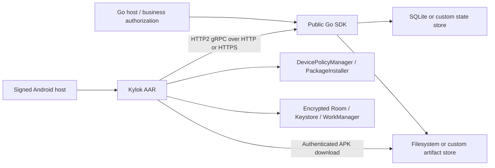

# Architecture

Kylok consists of an embeddable Go management engine and an Android DPC AAR. This document describes current system boundaries. The [implementation plan](implementation-plan.md) tracks current N1–N4 contracts and planned N5–N7 work. Go and Android SDKs are built from the same source revision.

## Components

| Path | Responsibility |
| --- | --- |
| `proto/kylok/v1/` | Typed enrollment, inventory, desired apps/policies, operations, reports and errors. |
| `go/` | Public management APIs, agent handlers, persistence, artifact verification and optional committed-event notifications. |
| `android/kylok-dpc/` | Provisioning, durable sync, installation, policies/kiosk, recovery and read-only host status APIs. |
| `examples/minimal-server/` | Agent/APK listeners, TLS, local CLI and optional separately authenticated administrator console. |
| `examples/minimal-dpc/` | Host application identity, signing, network trust and status/actions UI. |

Examples use public APIs; SDKs have no consumer dependency. Go hosts authorize management calls before invoking the SDK. The example console owns a separate listener and private administrator token; the SDK's agent listener adds no administrator endpoint. Device credentials authorize only that device's sync and assigned APKs.

Go/Maven packages have independent version files and a same-source development pairing. [External consumer fixtures](sdk.md) use only distributed modules/AAR metadata; optional observers cannot change security decisions or durable results. Go event delivery uses one bounded worker with cancellation; Android status notifications run on the main thread. Both are best-effort and read-only. [Release tooling](releases.md) packages source/licenses and verifies artifact/source identity during local builds. Protected-main merges automatically publish signed development packages without rerunning PR tests.

## Construction and transport

`kylok.New` requires a verified signed DPC APK, device-reachable `PublicURL`, and `DataDir` for default persistence. Supply both `ports.StateStore` and `ports.ArtifactStore` to omit `DataDir`. Construction validates configuration/current schema, registers bootstrap content, and starts no listener. An optional event sink starts one worker. Drain handlers before `Close`; supplied providers/sinks remain host-owned.

HTTP/HTTPS with IP or DNS hosts are normal configurations. `BootstrapURL` optionally selects a separate APK origin. HTTP uses unencrypted HTTP/2 for gRPC and HTTP/1 for APKs; HTTPS verifies certificate/hostname trust. HTTP does not encrypt tokens or bearer credentials. Setup Wizard HTTPS trust is separate from the installed app's trust configuration.

`QRWithOrigins` selects API/bootstrap destinations for an existing token without changing its scope or integrity binding. The example enumerates interfaces accepted by its bind and permits a custom origin. Managed APK URLs are relative to the enrolled origin; Android rejects scheme/authority changes and redirects before sending credentials. Redrawing a QR does not retarget an enrolled device.

## Durable state and effects

SQLite is a single-node store with transactions, WAL and synchronous writes. Enrollment consumption/device creation/recovery receipt are atomic. Sync atomically authenticates, deduplicates a persisted request sequence, accepts reports, updates inventory and delivers a snapshot. Desired revision, reported revision and observed compliance remain distinct.

Assignment creates a durable idempotent operation and supersedes older pending work for that package. Leases bound delivery attempts; deadlines and attempt limits terminate unconfirmed work. An install RPC/report is not proof of compliance: success requires package/version/signer observation, and compliance compares current inventory with desired artifacts.

Android encrypts Room state with a Keystore AES key and keeps its enrollment private key in Keystore. Requests, reports, desired revisions, downloaded bytes and installer session IDs survive agent restarts. WorkManager schedules periodic and event-driven recovery without requiring validated internet. Package replacement uses the same identity/state and resumes pending verification/reporting.

APK metadata comes from verified signed content. Managed downloads require device/operation/lease authorization. Resumed bytes are checked against the immutable digest. Android checks SDK/ABI/features, metadata, signing compatibility and downgrade rules before commit. Installer callbacks cover failure and user-action-required outcomes; installed-state checks establish success. Staged data and uncommitted Kylok sessions are cleaned up without touching host-owned sessions.

Policy replacement advances the same desired revision as apps. Scope/key binding and current-snapshot observations are transactional; each rule has separate compliance. Android captures original admin settings and attempts before effects, reads effective state afterwards, and restores released controls from its journal. Kiosk waits for exact required app versions/signers; actual locked mode plus a current-boot callback confirms entry. Cached policy repair can run without server access. Hosts must not concurrently mutate those same admin settings.

See [policies](policies.md), [protocol](enrollment-protocol.md) and [manual checks](provisioning.md) for semantics and platform evidence still required.

## Host integration direction

The current facade uses explicit scopes and host authorization. Hosts can keep a mapping from scoped Kylok device IDs to their own external records and wrap SDK calls behind consumer-owned ports. Business identity, assets, authorization and workflows remain outside the SDK. An agent credential never authorizes administrative operations.

Current source includes scoped point reads/domain pages and enrollment correlation, optional PostgreSQL with shared SQL transaction semantics, transaction-bound replayable changes and persisted consistent projection scans. Android provides validated immutable scheduling options and typed managed app configuration with protected baseline/attempt journals. `EventSink` remains a separate best-effort wakeup; loss does not affect the durable feed. No generic privileged policy plugin, group scheduler or remote reboot/lock API is available. See [host contracts](host-integration.md) and [Android configuration](managed-configuration.md).

Do not assume a business transaction and SDK state update commit together. A host persists an intent, invokes Kylok with a stable request key where supported, and reconciles authoritative reads. Future feed/outbox contracts must preserve that recovery boundary and explicitly define retention and resnapshot behavior. See [implementation plan](implementation-plan.md#neutral-integration-boundary).
