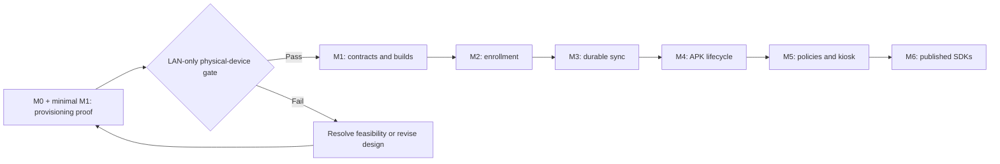

# Kylok implementation plan

**Status:** planned implementation, based on the [original design](../design.md). Only repository documentation is currently initialized. No commands below should be treated as available build tooling until their work package lands.

The [roadmap](../ROADMAP.md) defines public outcomes. This plan defines work packages and their validation. The [architecture](architecture.md) defines boundaries and invariants. Work IDs are stable planning references, not existing GitHub issues.

## Delivery order

Build a small end-to-end path first. The M0 proof can contain limited startup/build scaffolding from M1, but should not expand into a full engine before provisioning feasibility is established. Keep proof findings and transferable code; do not treat a prototype API as a frozen public contract.

## Starting state

| Item | Current state |
| --- | --- |
| Original design | Available in `design.md`. |
| README, architecture, roadmap, implementation plan | Available as the documentation baseline. |
| License | LGPL-3.0-only declaration with LGPL and companion GPL texts. |
| Go/Android/Protobuf code, examples, CI, tests | Not implemented. |
| Package identities and supported versions | Not selected/published. |
| Physical-device compatibility | Not tested. |

Do not add placeholder modules, success badges, fake package URLs, or CI jobs invoking nonexistent targets. Introduce each configuration with the code and validation it supports.

## M0 — Provisioning feasibility

### F0 — Confirm the test environment

**Depends on:** no implementation work.

Select a physical target device and record its API level, OEM, model, firmware/build, and reset/provisioning procedure. Confirm the Android SDK/AGP/Gradle/JDK combination, including availability of the design's compile/target API 37. Pin a working toolchain and document any gap rather than silently lowering the target.

Prepare LAN DNS, HTTPS trusted by the device's Setup Wizard, APK hosting, a signing key held outside Git, and a network setup that can block WAN while retaining LAN. Check official platform documentation for provisioning callbacks, offline extras, local-network access, CT/trust, and verification requirements that affect the target firmware.

**Validation:** another developer can reproduce the network and trust setup. Record prerequisites and unresolved platform assumptions; no device support is claimed from documentation alone.

### F1 — Build the smallest signed host and local server

**Depends on:** F0.

Introduce only enough of `android/kylok-dpc`, `examples/minimal-dpc`, and a local Go proof server to exercise provisioning. The AAR supplies receiver/activities and handles provisioning callbacks without the host Activity opening first. The host owns application ID and stable signing. Use Google Test DPC as a behavior reference and preserve any notices required for reused code.

Extract real signed-APK metadata, serve immutable APK bytes over HTTPS, and produce a QR payload containing Android-required component, checksum, offline intent, and bootstrap extras. Do not manually guess package/receiver/digest values. Include a provisioning status signal; any proof-only enrollment must be clearly identified and must not become an anonymous management interface.

**Validation:** signed APK verification, merged-manifest inspection, and QR metadata checks agree. The APK is downloadable from the target LAN using system-trusted HTTPS. Proof scripts and commands have reproducible instructions.

### F2 — Run the physical provisioning gate

**Depends on:** F1.

On an eligible factory-reset device with WAN blocked, scan the QR, download/install the host APK, exercise provisioning callbacks, confirm Device Owner, and confirm the agent can reach the server after satisfying network prerequisites.

Capture device/build identity, toolchain, network conditions, sanitized QR structure, artifact digest, callback/ownership results, and logs with secrets removed. Store the procedure and result in a future `docs/compatibility.md` plus test fixtures as appropriate.

**Validation/decision:** pass M0 only with actual LAN-only physical-device evidence. One passing device is a feasibility result. If it fails, diagnose bootstrap trust, Setup Wizard/OEM requirements, callback contracts, or LAN permissions before full M1 expansion. Test additional APIs/OEMs as they become available; retain unsupported/untested rows.

## M1 — Monorepo, contracts, and build foundations

### C1 — Establish build and package boundaries

**Depends on:** F2 for full expansion; a small subset supports F1.

Choose canonical package identities before publishing. Create one main Go module in `go/`, a separate example Go module, a development `go.work`, and one Android AAR module with the example application included in Gradle settings. Pin build tools and dependencies. Keep examples dependent only on public SDK APIs.

Introduce `proto/kylok/v1`, Buf configuration, deterministic generation, and useful root build targets alongside functioning implementations. Generate Go into `go/gen` and Kotlin into Android build output. Define how generated Go code is committed/checked and how clean builds regenerate Kotlin.

**Validation:** clean SDK and example builds, correct dependency direction, reproducible generation. Build the Go module without relying on workspace replacements (`GOWORK=off`) once dependencies support it. Commit Gradle wrapper support and dependency metadata when Android builds are introduced; do not require unpinned global tooling.

### C2 — Define the first cross-language contract

**Depends on:** C1 and M0 findings.

Specify Scope, Enrollment, Device, Policy, Application, Artifact, Operation, and ComplianceReport semantics. Begin with only the messages needed for enrollment and synchronization. Define stable identifiers, policy revisions, protocol/agent versions, capability reports, error/retry codes, pagination where required, and idempotency behavior. Reserve deleted field numbers.

Prove unary gRPC interoperability between Connect-Go and gRPC-Java/OkHttp/Protobuf Lite. Keep artifact transfer on a separate HTTPS endpoint. Define authentication metadata and the separation between unauthenticated enrollment bootstrap and authenticated device RPCs.

Before freezing enrollment messages, decide how a retry is bound to the original legitimate attempt and how credentials are safely recovered after a lost response. An arbitrary client-supplied idempotency key must not let another device recover credentials.

**Validation:** Go↔Kotlin round-trip and error mapping tests over the real transport, Buf lint, deterministic generation, and a breaking-change policy with a meaningful baseline. Draft API docs explicitly identify unstable types and behavior.

### C3 — Add CI for real targets

**Depends on:** C1, C2.

Add schema lint/generation checks, Go builds/tests, Android builds/unit tests, and example builds. Run breaking checks against an available comparison ref; handle the initial schema baseline explicitly. Record required checks and distinguish emulator tests from external physical-device gates.

**Validation:** CI executes the actual supported build targets from a clean checkout. License files, generated-code policy, caches, and required secrets are documented. Hardware gates remain visible even where they cannot run in hosted CI.

## M2 — Default services, provisioning, and enrollment

### E1 — Implement constructor and persistence contracts

**Depends on:** C1, C2.

Implement the public facade and validated options: PublicURL, bootstrap artifact/metadata, default DataDir, and complete custom-provider alternatives. Specify worker startup, context cancellation, handler route registration, and close ownership. The SDK returns a ready instance without starting a listener.

Introduce SQLite migrations and filesystem artifact storage. Define transactional token consumption/device creation, unique identities, idempotent requests, operation claims, and concurrency behavior in the public store contract. Provide conformance tests reusable by future adapters. Do not require unused DataDir when all persistent providers are supplied.

**Validation:** missing/conflicting options, bad APK metadata, unwritable or corrupt storage, migration failures, partially configured providers, and construction cleanup behave predictably. Default and custom paths satisfy the same invariants. No temporary database fallback.

### E2 — Implement bootstrap artifacts and QR generation

**Depends on:** E1, F2, C2.

Build `tools/apk-metadata` around signed APK verification. Extract package/receiver/version/digest/signing metadata and compare it to registered content. Use immutable content-addressed paths. Generate the platform-specific QR checksum encoding and required provisioning extras from verified metadata.

Serve bootstrap downloads before enrollment without requiring device credentials. Later artifact downloads have device/scope authorization. Keep credentials/tokens out of URLs and logs except where the provisioning contract requires bootstrap extras; treat QR contents as secrets.

**Validation:** metadata conflicts, mutable/replaced content, wrong digest/component, unreachable or untrusted bootstrap HTTPS, and expired enrollment all fail truthfully. Re-run the physical provisioning proof through the reusable SDK path.

### E3 — Implement secure enrollment on both sides

**Depends on:** E1, E2, C2 enrollment retry design.

Issue expiring high-entropy tokens bound to scope. Validate and atomically consume enrollment attempts, create one device identity, and return device-specific credentials. Hash credential verifiers server-side and protect device credentials with Android Keystore-backed mechanisms. Finalize reenrollment, revocation, rotation, and credential recovery behavior.

Implement Android lifecycle states and initialization/configuration ordering. Persist identity before declaring management ready. Provide authenticated agent handlers and a guarded optional management adapter; reject remote management construction without authentication/authorization.

**Validation:** factory reset through registry entry; expired/incorrect/replayed tokens; simultaneous enrollment attempts; lost response with legitimate retry; another device's retry attempt; cross-scope access; server/process restart at enrollment checkpoints. Every case has an explicit identity and credential outcome.

## M3 — Durable synchronization and recovery

### R1 — Implement registry and revisioned state

**Depends on:** E3.

Add inventory, actual capabilities, desired revisions, reported/observed state, compliance, and operation state. Define retryable versus terminal failures and policy supersession. Store pending reports and checkpoints durably in Room and the server store. Record operation/session identities before executing effects that may outlive the process.

**Validation:** duplicate requests/reports, concurrent sync, out-of-order responses, revision changes during work, scope isolation, and interrupted checkpoint writes maintain consistent state. RPC acceptance never marks policy application complete.

### R2 — Implement retry and lifecycle recovery

**Depends on:** R1.

Combine event-driven sync with WorkManager recovery, bounded backoff/jitter, boot/process recovery, and cancellation. Resume pending work and unsent reports after LAN loss, server restart, process termination, and reboot. Reject revoked credentials and expose recoverable versus terminal agent states.

**Validation:** fault injection across persist/request/effect/report boundaries, physical reboot recovery, repeated identical operation delivery, and a revoked-device reconnect. Reconcile external Android effects after a lost callback rather than claiming exactly-once execution.

## M4 — Verified APK installation and self-update

### A1 — Implement artifact registration and download

**Depends on:** R1, R2.

Provide local filesystem storage, immutable digests, retention/reference rules, authenticated post-enrollment downloads, and bounded streaming/staging. Resume downloads where supported. Begin with single/universal APKs; keep the contract extensible to installation sets without implementing split installs yet.

**Validation:** interruption, partial files, content changing behind metadata, checksum mismatch, unauthorized/cross-device access, insufficient storage, and referenced-artifact cleanup. Verify package, version, signing, and device compatibility before installation.

### A2 — Implement PackageInstaller execution

**Depends on:** A1.

Persist session identity, execute installation/update, handle success/failure/pending-user-action callbacks, and query installed state before reporting completion. Define recovery when the process dies after commit or before recording the callback. Do not treat user-action-required status as a successful silent install.

**Validation:** supported silent install/update on a physical device, user-action-required path, incompatible APK, signature mismatch, missing callback, interrupted session, and process/reboot recovery. Verify observed installed package and version.

### A3 — Prove DPC self-update

**Depends on:** A2.

Update the signed host DPC APK while retaining application identity, compatible signing, Device Owner role, credentials, revisions, and reports. Coordinate app-replacement lifecycle with worker recovery.

**Validation:** the updated DPC reconnects as the same device and completes its report. Record a failure when reconnection does not occur; do not infer success from the server's update request. Arbitrary downgrade/rollback remains outside the MVP.

## M5 — Policies, capability checks, and kiosk

### P1 — Build the reconciler and P0 handlers

**Depends on:** R2, A2, A3 for full milestone validation.

Implement capability validation, prerequisite ordering, durable reconciliation, actual-state verification, and per-result compliance. Deliver required apps/minimum versions/updates; Lock Task allowlist and kiosk app; screen capture, camera, debugging, uninstall, user/account restrictions; managed-app runtime permission grants within platform limits; and maximum time to lock.

Keep initial policy minimally restrictive. Require administrator intent for restrictions. Verify kiosk app installation before enabling Lock Task. Persist partial results and supersession decisions so retrying a policy does not incorrectly mark it applied.

**Validation:** repeated identical policies, missing kiosk package, unsupported capability, permission denial, callback failure, policy change mid-reconcile, reboot, partial success, and verified recovery. Use physical devices for platform behavior that emulators cannot establish.

## M6 — Public APIs, documentation, and release

### S1 — Finalize extension and host contracts

**Depends on:** E1–P1.

Validate the default path and replacements for storage, artifacts, events, authorization, validators, metadata, and Android policy/events. Document concurrency, timeouts, errors, initialization freeze, cancellation, event delivery, and resource ownership. Test hook exceptions, errors, and timeouts without bypassing framework invariants.

Publish focused guides for public APIs, protocol, integration, provisioning, security, and compatibility. Examples must show default integration, event hooks, a policy extension, and DPC self-update through public APIs. Their normal management path requires authentication and authorization.

**Validation:** a separate Go consumer and Android host integrate without copying implementation or providing mandatory replacement adapters. Custom providers run the same conformance checks as defaults.

### S2 — Establish release evidence and publishable packages

**Depends on:** S1 and all milestone gates.

Set independent SDK versions, the supported protocol/server/agent window, canonical Go module tags, Maven metadata, source packages, signing/publishing secrets, release notes, and license/third-party notices. Ensure Go module archives and Android distributions carry applicable license texts/notices, including required companion terms. The root license alone is not an archive-content check for the nested Go module.

Before public publication, dry-run package assembly and inspect archives. Then validate release candidates from the chosen package registries with consumers outside `go.work` and without local Android project substitution. Package publication remains an explicit release operation.

**Validation:** all thirteen [v1 release acceptance gates](../ROADMAP.md#v1-release-acceptance), reproducible package assembly, public-API-only examples, clean external consumer builds, compatible server/agent combinations, and an honest hardware support matrix. Follow the [GitHub publishing guide](github-publishing.md) for repository metadata and tag conventions.

## Required evidence matrix

This is a test plan. There are no passing results yet.

| Area | Required evidence |
| --- | --- |
| Protocol | Buf lint/breaking checks, deterministic generation, Go↔Kotlin integration. |
| Go core/store | Unit/race tests, state-machine tests, migrations, transaction and concurrency conformance. |
| Transport and access | Authentication, scope isolation, authorization, credential revocation, error mapping. |
| Android core | Kotlin reconciliation/state tests, initialization ordering, durable storage recovery. |
| Android platform | Instrumented enrollment/sync, Device Owner policies, APK lifecycle, kiosk, recovery across API 33–37 targets. |
| Platform network changes | Toolchain/platform verification and applicable LAN permission/trust tests, especially the design's API 37 target. |
| Provisioning | Physical-device QR tests by model/firmware with WAN blocked and recorded TLS conditions. |
| Packages/examples | Independent SDK builds, manifest validation, real release-candidate consumer integration. |

Required failures include expired/invalid/replayed tokens, lost enrollment response, LAN loss during download/install, digest/signing mismatch, incompatible APK, policy changes during reconciliation, process kill/reboot, server restart, denied LAN access, untrusted TLS, metadata/content disagreement, failed DPC reconnection, and extension errors/timeouts.

## Completing a work package

Each implementation change should link a work ID and state the observable behavior, dependencies, validation, and remaining gaps. Document changed contracts beside their implementation. Run the checks appropriate to the changed behavior; explicitly record hardware tests that were not performed. Close a milestone only with its exit-gate evidence, and update current status in the README and roadmap when that evidence exists.
